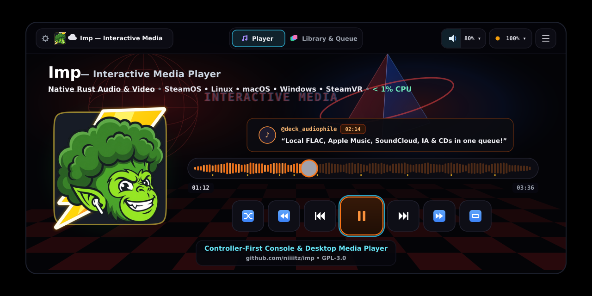
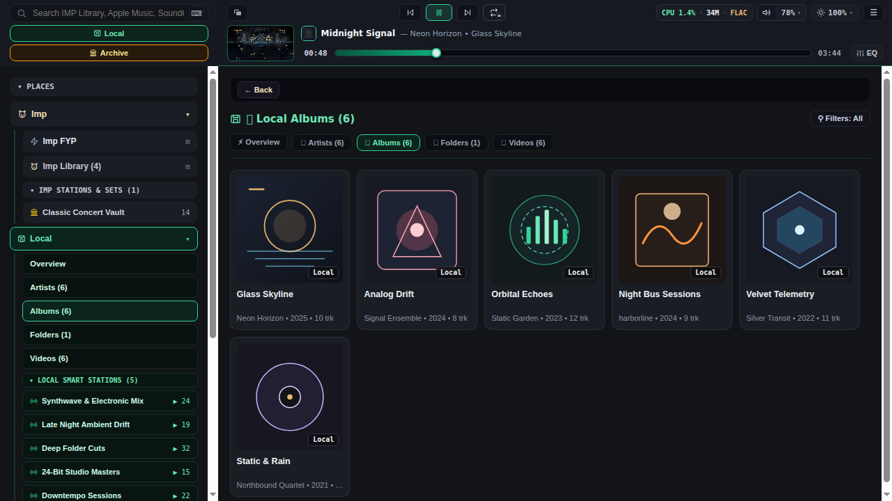
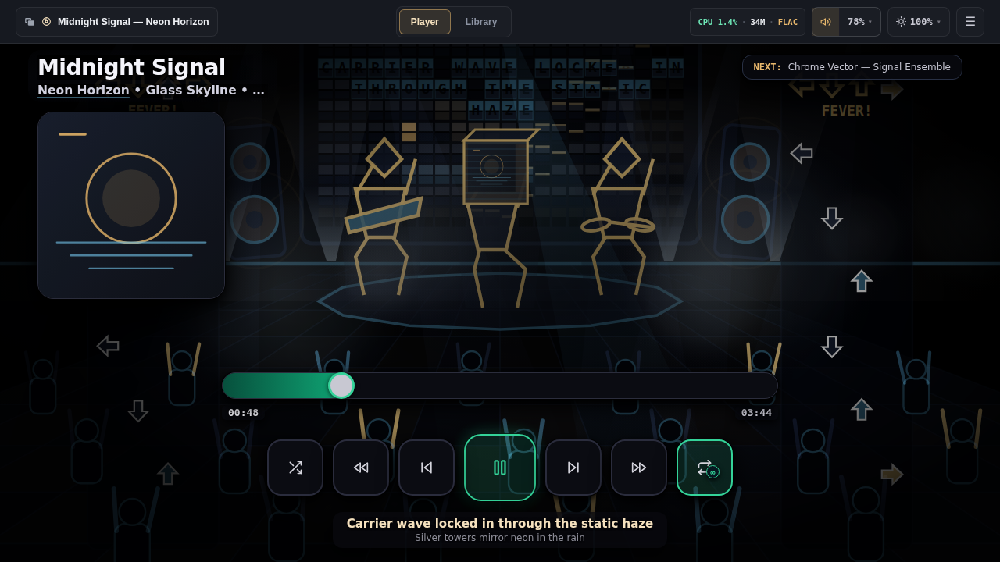
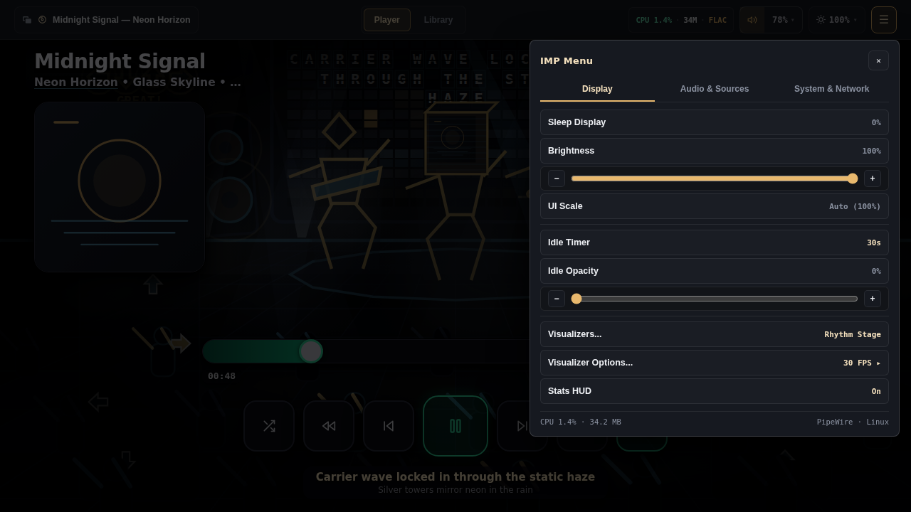

<div align="center">
  

  # IMP — Interactive Media Player

  **A lightweight, controller-first & desktop-native audio and video player for SteamOS, Linux, macOS, Windows, and SteamVR.**

  [](https://github.com/niiiitz/imp/releases)
  [](#installation)
  [](#development--building-from-source)
</div>

---

## ⬇️ Download IMP (`v1.0.2`)

Grab the ready-to-run installer or portable bundle for your platform directly below (or browse **[All Releases](https://github.com/niiiitz/imp/releases)**):

| Platform | Direct Download (`Latest Stable`) | Quick Install / Launch |
| :--- | :--- | :--- |
| **Steam Deck / SteamOS / Linux (`x86_64`)** | **[`imp-steamos-userland-x86_64.tar.gz`](https://github.com/niiiitz/imp/releases/latest/download/imp-steamos-userland-x86_64.tar.gz)** | Extract & run `./install-steamos.sh` *(userland `systemd` service + Desktop shortcut)* |
| **Steam Frame / Linux (`aarch64` ARM64)** | **[`imp-steamos-userland-aarch64.tar.gz`](https://github.com/niiiitz/imp/releases/latest/download/imp-steamos-userland-aarch64.tar.gz)** | Extract & run `./install-steamos.sh` *(native ARM64 + SteamVR overlay)* |
| **Decky Loader Add-On (`SteamOS QAM`)** | **[`imp-decky.zip`](https://github.com/niiiitz/imp/releases/latest/download/imp-decky.zip)** | In Decky Loader: **Settings → Developer → Install Plugin from ZIP** |
| **macOS (`Apple Silicon arm64`)** | **[`IMP-macos-arm64.zip`](https://github.com/niiiitz/imp/releases/latest/download/IMP-macos-arm64.zip)** | Unzip and drag **`IMP.app`** to `/Applications` *(Developer ID signed & Apple notarized)* |
| **Windows (`x86_64` Portable)** | **[`imp-windows-portable-x86_64.zip`](https://github.com/niiiitz/imp/releases/latest/download/imp-windows-portable-x86_64.zip)** | Unzip anywhere and launch **`Imp.exe`** *(zero-install portable folder)* |

---

## Overview

Playing your own music, soundtracks, and video across a Steam Deck, desktop, living-room console, or VR headset shouldn't require a heavy web browser or five separate apps.

**IMP** pairs a tiny native Rust media daemon with a high-contrast, OLED-friendly interface built for gamepads, VR pointers, and mouse & keyboard alike.

| <a href="docs/screenshots/library_queue.png"></a> | <a href="docs/screenshots/lyrics_viz.png"></a> |
| :---: | :---: |
| **Unified Library & Hybrid Playlists**<br><sub>Local media, Steam OSTs, Apple Music, SoundCloud, Internet Archive & Optical Discs</sub> | **Audio Visualizers & Synced Lyrics (`LRCLIB`)**<br><sub>12 built-in High-DPI reactive visualizers (`Glyph`, `AVS`, `64K`, `Vertigo`, `Trapper`, `Rhythm Stage`, `Midnight Mountain`, `Cosmic Warp`, `Coral Reef`, `Retro Arcade`, `Vaporwave`, `Dark Fantasy Sanctum`)</sub> |
| <a href="docs/screenshots/video_theatre.png"></a> | <a href="docs/screenshots/player_with_select_overlay.png"></a> |
| **Card & Full-Viewport Video Theatre**<br><sub>Stream quality & subtitle switching with auto-hiding HUD</sub> | **`SELECT` Quick Menu & Track Actions**<br><sub>Queue next, route to Hybrid Playlists, jump to album/artist, and toggle visualizers & lyrics</sub> |

---

## High-Level Features


* **One Queue for Audio & Video (`★ Hybrid Playlists`):** Mix local music & video files, **Steam Soundtracks**, **Apple Music**, **SoundCloud** tracks & DJ mixes, **Internet Archive** films & live concerts, and physical **Audio CDs / DVDs** inside a single playlist.
* **12 Reactive High-DPI Visualizers & Live Synced Lyrics (`LRCLIB`):** Cycle through 12 built-in real-time visualizers (**`Glyph`**, **`AVS`**, **`64K`**, **`Vertigo`**, **`Trapper`**, **`Rhythm Stage`**, **`Midnight Mountain`**, **`Cosmic Warp`**, **`Coral Reef`**, **`Retro Arcade`**, **`Y2K Vaporwave`**, and **`Dark Fantasy Sanctum`**) paired with automatic time-synced lyrics, timed `@username` SoundCloud comments, retro VHS track chyrons, and interactive waveform scrubbing.
* **Card & Theatre Video Player:** Watch video inside the Now Playing card or expand into full-viewport **Theatre Mode** (`F`) with stream quality and subtitle selection. Flip back to your library (`L1`/`R1`) and audio continues seamlessly.
* **Pin Only What You Want (`📌`):** Browse cloud catalogs and local folders on demand, and pin individual albums, movies, or playlists into your **IMP Library** for instant access.
* **Controller-First, Mouse & Keyboard Ready:** Inspired by the PlayStation 3 XrossMediaBar (XMB) for effortless D-Pad navigation, while automatically switching to a clean pointer & keyboard UI (`Space` Play/Pause, `/` search, media keys) when you move a mouse.
* **Tiny Native Rust Daemon:** Runs in the background (`~5 MB` binary) with native OS integration — **Linux `MPRIS2` & System Tray**, **macOS Menu Bar & Control Center (`MPNowPlayingInfoCenter`)**, **Windows System Tray**, and **SteamVR Dashboard Overlay**. Close the window and your media keeps playing.

<br clear="right" />

---

## Supported Platforms & Media Sources

| Category | Supported Targets |
| :--- | :--- |
| **Platforms** | **SteamOS / Linux** (`x86_64` & `aarch64` Steam Frame), **macOS** (`Apple Silicon arm64`), **Windows** (`x86_64`), **SteamVR** (`OpenVR` overlay) |
| **Audio & Video Sources** | **Local Audio & Video** (`FLAC`, `MP3`, `AAC/M4A`, `OGG`, `WAV`, `MP4`, `MKV`, `WebM`), **Steam Soundtracks** (auto-discovered), **Apple Music**, **SoundCloud**, **Internet Archive** (`archive.org`), **Optical Discs** (`Audio CD` + `DVD-Video`) |

---

## Installation

Grab the package for your platform from the **[latest GitHub Release (`v1.0.2`)](https://github.com/niiiitz/imp/releases/latest)**:

### SteamOS / Bazzite / Linux (`x86_64` & `aarch64`)

Download **[`imp-steamos-userland-x86_64.tar.gz`](https://github.com/niiiitz/imp/releases/latest/download/imp-steamos-userland-x86_64.tar.gz)** (or **[`imp-steamos-userland-aarch64.tar.gz`](https://github.com/niiiitz/imp/releases/latest/download/imp-steamos-userland-aarch64.tar.gz)** for ARM64 / Steam Frame). Installs into `~/.local/share/imp` as a `systemd --user` service without modifying read-only system partitions:

```bash
rm -rf /tmp/imp-steamos-userland && tar -xzf imp-steamos-userland-x86_64.tar.gz -C /tmp
/tmp/imp-steamos-userland/install-steamos.sh
```

* **Launch:** Open **IMP** from your application menu, run `imp`, or right-click **IMP** → **Add to Steam** for Game Mode & SteamVR.
* **Optional Decky Plugin:** Download **[`imp-decky.zip`](https://github.com/niiiitz/imp/releases/latest/download/imp-decky.zip)** and install via Decky Loader's *Install from ZIP* menu for a Quick Access Menu drawer.

### macOS (`Apple Silicon arm64`)

Download **[`IMP-macos-arm64.zip`](https://github.com/niiiitz/imp/releases/latest/download/IMP-macos-arm64.zip)**, extract `IMP.app` into `/Applications`, and launch **IMP**.
* Closing the window (`Cmd+W`) keeps playback active in the **macOS Menu Bar** (`NSStatusItem`) with full **Control Center / Media Key** integration.

### Windows (`x86_64` Portable)

Download **[`imp-windows-portable-x86_64.zip`](https://github.com/niiiitz/imp/releases/latest/download/imp-windows-portable-x86_64.zip)**, extract anywhere, and run `Imp.exe`.

### In-App Updates (`Alpha` & `Stable` Channels)

Open the top-right **Settings (`☰`)** drawer to switch between the **Alpha** and **Stable** release channels and check for updates in place.

---

## Controls Quick Reference

| Action | Gamepad | Desktop Keyboard |
| :--- | :--- | :--- |
| **Play / Pause** | `A` *(in Player)* | `Space` or `K` |
| **Previous / Next Track** | `D-Pad Left / Right` *(in Player)* | `← / →` *(in Player)*, `B / N`, `< / >`, or `Cmd/Ctrl + ← / →` |
| **Seek `-10s` / `+10s`** | `L2` / `R2` Triggers | `J / L` or `- / +` |
| **Volume & Mute** | `D-Pad Up / Down` *(in Player)* or `Right Stick Y` | `↑ / ↓` *(in Player)*, `Cmd/Ctrl + ↑ / ↓`, or `M` (Mute) |
| **Switch Tabs (`Player` / `Library`)** | `L1` / `R1` Bumpers | `1` / `2` or `[` / `]` |
| **Shuffle / Repeat** | `X` (Shuffle) / `Y` (Repeat in Player) | `S` or `X` (Shuffle) / `R` (Repeat) |
| **Pin Item / Track Actions** | `Y` or `Select` *(in Library)* | Click `📌` / `⋯` or press `Y` |
| **`SELECT` Menu (Visualizer / Lyrics / Track Options)** | `Select` / `View` *(in Player)* | Click top-left `⚙️` pill or press `Tab` |
| **Fullscreen / Video Theatre** | `Select` → Full Screen / `A` on `⛶` | `F` or `F11` (`Esc` to exit) |
| **Search Library & Sources** | Focus Search + `A` (On-Screen Keyboard) | `/` or `Cmd/Ctrl + F` |
| **Settings Drawer (`☰`)** | `Start` / `Options` | `P` or `F1` |

---

## Development & Building from Source

IMP splits playback and UI into two lightweight layers:
1. **Rust Daemon (`imp --daemon`):** Indexes media into SQLite, decodes audio (`Symphonia` + `Rodio`), streams cloud & archival media, reads optical discs, and drives native OS media controls + `OpenVR`.
2. **Console UI (`http://127.0.0.1:18888`):** React + TypeScript frontend synchronized over WebSockets.

```bash
# Run in development mode
cargo run -p imp -- --daemon
npm run dev:ui

# Build release bundles into dist/
./packaging/scripts/package-release.sh                         # Linux / SteamOS (x86_64)
IMP_TARGET_ARCH=aarch64 ./packaging/scripts/package-release.sh # Steam Frame / Linux (aarch64)
./packaging/scripts/package-macos.sh                           # macOS IMP.app bundle (arm64)
./packaging/scripts/package-windows.sh                         # Windows portable ZIP (x86_64)
```

---

## Attributions & Provenance

IMP builds on the work of open-source maintainers and public archives — including **[Jake Johnson (`@jjjake/internetarchive`)](https://github.com/jjjake/internetarchive)** and the **[Internet Archive (`archive.org`)](https://archive.org/developers/)**, **[Tran Xuan Thang (`LRCLIB`)](https://github.com/tranxuanthang/lrclib)**, **Symphonia**, **Rodio**, **Lofty**, **VideoLAN (`libdvdcss` / `libdvdread`)**, **MusicBrainz & Cover Art Archive**, **Souvlaki**, **OpenVR**, and **Decky Loader**.

See **[`ATTRIBUTIONS.md`](ATTRIBUTIONS.md)** for the complete provenance ledger and technical acknowledgments.

---

## Disclaimer

> **IMP (Interactive Media Player)** is an independent open-source project and is **not** affiliated with, endorsed by, or sponsored by **Valve Corporation**, **Apple Inc.**, **SoundCloud**, **Internet Archive**, or the **MetaBrainz Foundation**. All product and company names are trademarks of their respective owners and are used strictly for identification and interoperability (nominative fair use).
